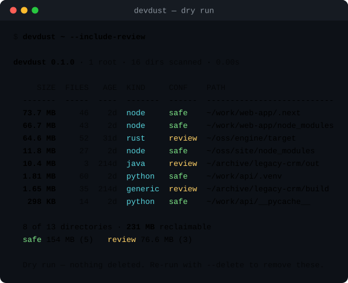
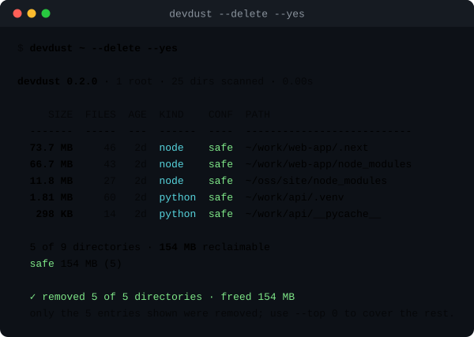
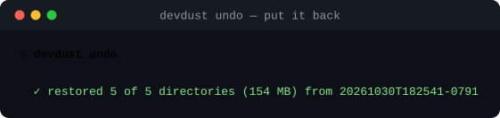

# devdust

**Projelerinizin geride bıraktığı build çıktılarını ve cache'leri bulun — sonra güvenle silin.**

[](https://www.python.org)
[](pyproject.toml)
[](#proje-durumu)
[](LICENSE)



`devdust` projelerinizi tarar, bulduğu her `node_modules`, `__pycache__`,
`.next`, `target` ve `.venv` klasörünü bildirir, kaç GB yer tuttuğunu söyler ve
**yalnızca siz istediğinizde**, yalnızca size gösterilen klasörleri siler.

- **Varsayılan olarak kuru çalışma (dry run).** `--delete` olmadan hiçbir şey silinmez.
- **İki güven seviyesi.** Yeniden üretilmesi ucuz cache'ler `safe`; `build/`,
  `bin/`, `vendor/` gibi ismi tartışmalı klasörler `review` ve siz açıkça
  istemedikçe listeye girmez.
- **Akıllı budama.** Bir klasör eşleştiğinde boyutu bir kez ölçülür, içine
  girilmez; böylece toplamlar dürüst kalır ve tarama hızlı olur.
- **Sıfır bağımlılık.** Tek `pip install`, denetlenecek tedarik zinciri yok.

## Proje durumu

> **Bu çalışan bir demo ve gelişmeye devam edecek.** 🚧
>
> `devdust` küçük ama baştan sona çalışan bir araç: tarıyor, filtreliyor,
> raporluyor, siliyor; testleri ve CI'ı var. Yine de bu bir **fikir demosu**,
> olgun bir ürün değil. **0.3.0** sürümü erken bir önizleme: CLI'ın, çıktının ve
> kural tablosunun sürümler arasında değişmesini bekleyin.
>
> Demoyu erken yayınlamanın amacı, son aracın şeklini baştan görünür ve
> denenebilir kılmak. Geri bildirim, hata raporları ve "benim ekosistemimi de
> öğren" istekleri yol haritasını ilerleten şeyler.

### Yol haritası

| | Madde |
| --- | --- |
| ✅ 0.1.0 | Tarama, filtreler, iki güven seviyesi, güvenli silme, JSON çıktısı |
| ✅ 0.2.0 | `.devdust.toml` + `devdust init`, `--summary` dağılımı, yalnızca Python 3.11+ |
| ✅ 0.3.0 | Geri alma: `--delete` çöp kasasına taşır, `devdust undo` geri getirir, `devdust purge` işi bitirir |
| 🔜 0.4.0 | Çok büyük ağaçlar için paralel tarama (`--jobs`) |
| 🔜 | `.gitignore` farkındalığı ve tek dosyada proje bazlı ayarlar |
| 🔜 | Etkileşimli seçim ekranı: klasörleri tek tek seçme |
| 💭 | Editör / CI entegrasyonları, JSON şeması, `devdust doctor`, kabuk tamamlama |

Öncelikler gerçek kullanımla şekilleniyor — iş akışınıza eksik gelen bir şey
varsa issue açın.

---

## Kurulum

```console
$ pipx install devdust        # önerilen: izole, her zaman PATH'te
$ uv tool install devdust     # ya da uv ile
$ pip install devdust         # ya da mevcut ortama
```

Depodan:

```console
$ git clone https://github.com/tatlisbeyefendi/devdust.git
$ cd devdust
$ pipx install .
```

Linux ve macOS'ta Python 3.11+. Windows denenmedi (yol işlemleri platformdan
bağımsız, ama testler yalnızca POSIX'te koşuyor). Alt sınırın 3.11 olmasının
sebebi, ayar dosyasının standart kütüphanedeki `tomllib` ile okunması — böylece
"sıfır bağımlılık" sözü korunuyor.

## Hızlı başlangıç

```console
$ devdust                     # bulunduğunuz dizinde kuru çalışma
$ devdust ~/work ~/oss        # birden fazla kök dizin
$ devdust --min-size 100MB    # sadece büyük olanlar
$ devdust --older-than 90d    # 3 aydır dokunulmamış cache'ler
$ devdust --summary           # yer tam olarak nereye gidiyor?
$ devdust --delete            # gördüklerinizi silin (onay ister)
```

`--delete` verene kadar her şey bir rapordur:



## Neleri bulur?

| Tür | Örnekler |
| --- | --- |
| `python` | `__pycache__`, `.venv`, `venv`, `.pytest_cache`, `.mypy_cache`, `.ruff_cache`, `.tox`, `.nox`, `*.egg-info`, `.hypothesis` |
| `node` | `node_modules`, `.next`, `.nuxt`, `.svelte-kit`, `.turbo`, `.parcel-cache`, `.vite`, `.angular`, `bower_components` |
| `rust` | `target` |
| `java` | `.gradle`, `out` |
| `dotnet` | `bin`, `obj` |
| `ios` / `swift` | `Pods`, `DerivedData`, `.build` |
| `terraform` | `.terraform`, `.terragrunt-cache` |
| `generic` | `build`, `dist`, `vendor`, `.cache` |

Güncel ve tam liste için:

```console
$ devdust rules
```

## Güvenlik modeli

Klasör silmek sağduyu gerektirir; `devdust`'un kendi kuralları var:

1. **Varsayılan kuru çalışma.** `--delete` gerekir ve yalnızca ekrana basılan
   kayıtlar silinir (`--top 25` 25 kayıt basar, 25 tanesini siler — hepsi için
   `--top 0`).
2. **İsmi tartışmalı olanlar ikinci onay ister.** `build/`, `bin/`, `obj/`,
   `target/`, `vendor/` gibi klasörler `review` seviyesindedir: sadece
   `--include-review` ile listelenir.
3. **Yıkıcı seçenekler ayar dosyasından açılamaz.** `.devdust.toml` neyin
   *raporlanacağını* değiştirebilir; `--delete` veya `--yes`'i asla açamaz.
   Dosya silmek her seferinde komut satırında verilen açık bir karardır.
4. **Taranan kökler asla aday olmaz.** `devdust`'u bir `node_modules`
   klasörüne yönlendirirseniz, o klasörün kendisini silmeyi önermez. `$HOME`,
   çalışma dizini ve dosya sistemi kökü de korunur.
5. **Sembolik linkler ne izlenir ne silinir.** `/` hedefini gösteren bir link
   "kazanılabilir alan"ı şişiremez, veri kaybına da dönüşemez.
6. **Yollar taranan kökün içinde olmak zorunda.** Aksi hâlde silme koruması
   reddeder.
7. **Hata tek klasörle sınırlı kalır.** Yazılamayan bir kayıt çalışmayı
   durdurmaz; stderr'e raporlanır ve çıkış koduna yansır. Salt-okunur ağaçlar
   bir kez açılır ve yeniden denenir.

`--delete` varsayılan olarak hiçbir şeyi yok etmez: klasörleri bir **çöp
kasasına** taşır ve nereden geldiklerini hatırlar. Yanlış bir `--kinds` ya da
fazla cömert bir `--top` artık yeniden kurma değil, bir `devdust undo` demek.
`--hard` kasayı atlar ve gerçekten silen tek moddur.

## Geri alma



```
$ devdust ~ --delete --yes
  ✓ stashed 5 of 5 directories (154 MB) as 20261030T182541-0791
  undo with: devdust undo 20261030T182541-0791

$ devdust stash                    # kasada ne var?
$ devdust undo                     # en yeni kasa, geldiği yere geri
$ devdust undo 20261030T182541     # belirli bir kasa (tekil önek yeter)
$ devdust undo --only node_modules # sadece biri
$ devdust purge --all              # geri almak yok: temelli gitti
```

Kasa `~/.local/state/devdust/stash` altında durur (`$DEVFDUST_STASH` veya
`$XDG_STATE_HOME` değiştirebilir); her çalıştırma için bir klasör ve bir
`manifest.json` yazılır. Manifest; özgün mutlak yolu, ölçülen boyutu ve eşleşen
kuralı saklar — undo tahmin etmez, manifesti okur. En yeni 8 kayıt tutulur,
eskiler otomatik temizlenir; böylece kasa, çözmek için kurulduğu disk sorununa
kendisi dönüşmez.

Geri konacak yolda bir şey varsa `undo` reddeder ve söyler; `--force` üzerine
yazar.

## Ayarlar

Aynı bayrakları tekrar tekrar yazmamak için tercihler `.devdust.toml` dosyasında
tutulabilir:

```console
$ devdust init          # her şeyi yorum satırı olarak yazan başlangıç dosyası
```

```toml
# .devdust.toml
[devdust]
paths = ["~/code", "~/oss"]     # varsayılan kökler
min_size = "20MB"               # küçükleri görmezden gel
older_than = "30d"              # sadece kimsenin dokunmadıkları
kinds = ["node", "python"]      # kendi alanında kal
exclude = ["vendor", "*-backup"]
summary = true                  # dağılımı her zaman göster
```

Aranma sırası:

1. `--config DOSYA` verildiyse o,
2. bulunulan dizinde, sonra üst dizinlerde `.devdust.toml` (arama `$HOME`'da
   durur),
3. `$XDG_CONFIG_HOME/devdust/config.toml` (varsayılan
   `~/.config/devdust/config.toml`).

Komut satırı bayrakları her zaman dosyadan önceliklidir, `--no-config` tüm ayar
dosyalarını yok sayar ve bilinmeyen anahtarlar öneriyle birlikte reddedilir:

```console
$ devdust
devdust: config: /home/dev/.devdust.toml: unknown key(s) in [devdust]:
  'min_sizes' (did you mean 'min_size'?). Known keys: paths, exclude, kinds,
  min_size, older_than, include_review, top, sort, color, summary
```

`devdust init` varsayılan olarak hiçbir şeyi değiştirmez: bütün ayarlar yorum
satırıdır, yani dosya önce dokümantasyon, sonra ayardır.

## Kullanım

```
devdust [PATH ...] [seçenekler]
devdust rules            # bilinen tüm klasör desenleri
devdust stash            # --delete ne bıraktı
devdust undo [ID]        # geri koy
devdust purge [ID|--all] # artık geri alamayacak hâle getir
devdust init [DİZİN]     # başlangıç .devdust.toml dosyası yazar
```

| Seçenek | Ne yapar |
| --- | --- |
| `--delete` | Gösterilen klasörleri çöp kasasına taşır (önce sorar) |
| `--hard` | `--delete` ile: gerçekten siler, geri alınamaz |
| `--stash-dir YOL` | Kasanın yeri (varsayılan `~/.local/state/devdust/stash`) |
| `-y`, `--yes` | Onay sorusunu atlar (stdin TTY değilse zorunlu) |
| `--include-review` | `build/`, `bin/`, `target/` gibi isimleri de değerlendirir |
| `--kinds LIST` | Ekosistem filtresi, örn. `--kinds node,python` |
| `--exclude GLOB` | Bu glob'a uyan klasörleri atlar (tekrarlanabilir) |
| `--min-size SIZE` | `SIZE`'dan küçük eşleşmeleri yok sayar (`50MB`, `1.5g`, `512`) |
| `--older-than AGE` | Yalnızca `AGE` boyunca dokunulmamış olanlar (`30d`, `12h`, `2w`) |
| `--max-depth N` | Kökün altında `N` seviyeden fazla derine inmez |
| `--top N` | En fazla `N` kayıt gösterir; `0` hepsi (varsayılan `25`) |
| `--sort {size,age,path,kind}` | Sıralama (varsayılan: en büyük önce) |
| `--summary` | Ekosistem bazında "yer nereye gidiyor" dağılımı ekler |
| `--config DOSYA` | Ayar dosyası aramak yerine bu dosyayı kullanır |
| `--no-config` | Tüm ayar dosyalarını yok sayar |
| `--json` | Makine okunur akıt (`--top` ile kısaltılmaz) |
| `--color {auto,always,never}` | Renk denetimi; `NO_COLOR` / `FORCE_COLOR` da dikkate alınır |
| `--version` | Sürümü yazar |

Çıkış kodları: `0` başarılı, `1` tarama veya silme hatası, `2` hatalı kullanım.

### `--summary` dağılımı

```console
$ devdust ~ --summary
  ...
  where the space goes
  node      152 MB  ███████████████             66%
  rust     64.6 MB  ██████                      28%
  java     10.4 MB  █                            5%
  python   1.81 MB  █                            1%
```

### JSON çıktısı

```console
$ devdust ~/work --json | jq '.totals'
{
  "size": 812345678,
  "size_human": "775 MB",
  "files": 43120,
  "directories": 12
}
```

Her kayıt `path`, `size`, `size_human`, `files`, `age_seconds`, `age_human`,
`kind`, `confidence` ve eşleşen `rule` alanlarını taşır. Çıktı ayrıca
`summary.by_kind` / `summary.by_confidence` toplamlarını ve kullanılan ayar
dosyasını (`yoksa null`) içerir. `--delete` ile birlikte kazanılan baytı ve
hataları taşıyan `removed` bloğu eklenir.

## Tarifler

```bash
# üç aydır el sürülmemiş, 50 MB üstü klasörlerin aylık temizliği
devdust ~/code --min-size 50MB --older-than 90d --delete

# CI runner'ında build öncesi yer açmak
devdust . --exclude .git --kinds node --delete --yes

# diski tam olarak ne yiyor?
devdust ~ --summary --top 0 --sort size --min-size 10MB

# zamanda yolculuk: geçen yıldan beri dokunulmamış projeler
devdust ~/code --sort age --top 10
```

Kabuğunuza bir alias koymak en sık senaryoyu iki harfe indirir:

```bash
alias dd='devdust ~/code --min-size 20MB'
```

## Geliştirme

```console
$ make install     # editable kurulum + dev bağımlılıkları
$ make test        # pytest
$ make lint        # ruff check + ruff format --check
$ make demo        # docs/demo*.svg dosyalarını gerçek CLI çıktısından üretir
```

Demo görselleri `scripts/render_demo_svg.py` ile gerçek çıktıdan üretilir;
böylece dokümantasyon koddan kopmaz. `scripts/make_demo_tree.py` ise bu
görsellerin kaynağı olan sahte çalışma alanını kurar.

Dizin yapısı:

```
src/devdust/
  cli.py          argümanlar, çıktı, çıkış kodları
  config.py       .devdust.toml keşfi, okuma ve doğrulama
  scanner.py      dolaşma, boyut hesabı, güvenlik korumaları, silme
  rules.py        desen tablosu ve güven seviyeleri
  formatting.py   boyut, yaş, renk, tablo
tests/            birim + uçtan uca testler; ağ yok, diskte fixture yok
```

Yeni bir desen `src/devdust/rules.py` içinde tek satırlık bir iştir; yeni bir
ayar anahtarı ise `KNOWN_KEYS`, okuyucu, `template()` ve dokümanların birlikte
güncellenmesi demektir. Ayrıntılar [CONTRIBUTING.md](CONTRIBUTING.md).

## SSS

**Neden `npkill` / `cargo clean` / `rm -rf` değil?**
Onlar tek bir ekosistemi kapsar. `devdust` tüm çalışma alanını tek geçişte
tarar, muhakeme edilebilir bir güvenlik modeli sunar ve script'ler için makine
okunur çıktı verir.

**Sembolik linkleri izler mi?**
Hayır, asla. Link'li klasörler ölçüm sırasında atlanır ve silme koruması
tarafından reddedilir.

**`.gitignore`'a uyar mı?**
Henüz hayır ([yol haritasında](#yol-haritası)). `devdust` klasör isimlerine
bakar, depo kurallarına değil; cache'e benzeyen ve görmezden gelinen yollar yine
raporlanır (genelde istediğiniz budur) ve `.git/` içine hiç girilmez.

**Boyutlar "görünen" boyut mu, diskte kapladığı mı?**
Görünen boyut: her dosyanın `st_size` toplamı, yani `du --apparent-size`. Clone,
reflink veya hardlink kullanan dosya sistemlerinde (APFS, Btrfs, `pnpm` store)
geri kazanacağınız alan gösterilenden az olabilir.

**Silmeyi geri alabilir miyim?**
0.2.0'da hayır — silme kalıcı. Çöp kutusu / stash desteği sıradaki kilometre
taşı.

**Windows?**
Çalışması gerekir ama denenmedi; hatayı testle birlikte bildirirseniz sevinirim.

## Lisans

MIT — [LICENSE](LICENSE) dosyasına bakın.

---

<sub>English documentation: [README.md](README.md)</sub>
